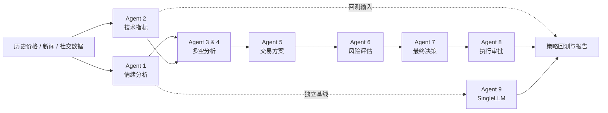

# Multi-Agent Synergistic Framework for Cryptocurrency Trading

> 一个将市场情绪、技术指标、多个 LLM 决策角色与回测评估串联起来的 BTC 研究项目。

**项目结果速览** · 回测区间：`2025-03-10` — `2026-03-10` · 标的：**BTC**

| 多 Agent 策略累计收益 | 年化收益 | Sharpe Ratio | 最大回撤 |
|:---:|:---:|:---:|:---:|
| **+48.09%** | **+47.93%** | **1.34** | **−20.78%** |

## 项目简介

本项目实现一个面向 BTC 的多 Agent 日频研究与回测流程。系统先整理新闻/社交媒体情绪和价格技术指标，再让多种角色分别分析、辩论、控制风险并形成最终执行建议。回测报告将多 Agent 策略与 Buy & Hold、SMA、布林带和单 LLM 基线进行比较。

仓库已包含历史价格、情绪数据、Agent 日志以及生成好的图表和指标文件。查看下方结果不需要配置 API；配置密钥后可以运行模型流程并重新生成结果。

## 回测结果

下表来自仓库中的 [strategy_metrics_summary.csv](Multi-agent%20Crypto%20Trading/visualization/strategy_visualization_2025-03-10_2026-03-10_default_now/strategy_metrics_summary.csv)。收益和风险指标均为该历史区间的回测结果，不代表未来表现。

| 策略 | 累计收益 | 年化收益 | 年化波动率 | Sharpe | 最大回撤 |
|---|---:|---:|---:|---:|---:|
| **Multi-Agent** | **48.09%** | **47.93%** | 35.74% | **1.34** | −20.78% |
| SingleLLM | 15.91% | 15.86% | 25.16% | 0.63 | −25.45% |
| SingleBollinger (10, 2.5) | 5.99% | 5.98% | **12.82%** | 0.47 | **−7.64%** |
| SMA (7/20) | −5.26% | −5.25% | 24.02% | −0.22 | −36.08% |
| Buy & Hold | −12.20% | −12.17% | 44.64% | −0.27 | −49.94% |

### 累计收益对比


### 回撤对比


### 交易与执行概览


> **结果说明：** 指标取自项目已保存的回测输出；年化指标按日频、每年 365 天计算，Sharpe 的无风险利率设为 0。实际交易中的手续费、滑点、流动性、数据时点和模型输出都可能显著影响结果。此项目用于研究和演示，不构成投资建议。

## Agent 工作流



| 阶段 | 职责 |
|---|---|
| Agent 1 | 新闻及社交文本情绪处理 |
| Agent 2 | 价格数据和 RSI、MACD、均线等技术信息 |
| Agent 3–4 | 分别生成看多与看空论据 |
| Agent 5 | 综合观点，形成交易方案 |
| Agent 6 | 评估风险与仓位约束 |
| Agent 7 | 输出方向、置信度和最终决策 |
| Agent 8 | 审核并形成执行计划 |
| Agent 9 | 独立单 LLM 基线，用于对照 |

## 目录结构

```text
Multi-agent Crypto Trading/
├── main.py                         # 主入口：数据处理与流程编排
├── BTC.csv / ETH.csv               # 本地历史行情
├── bitcoin_tweets_cleaned.csv      # 清洗后的比特币社交文本
├── historical_news.csv             # 历史新闻数据
├── agents/                          # Agent 角色实现
├── runners/
│   ├── run_pipeline.py              # 多 Agent 阶段编排
│   └── run_daily_decision.py        # 单日决策入口
├── artifacts/agent_logs/            # Agent 日志、缓存和中间结果
├── backtest/                        # 回测指标计算
├── strategies/                      # Buy & Hold、SMA、布林带策略
└── visualization/
    ├── plot_yearly_strategy_metrics.py
    └── strategy_visualization_2025-03-10_2026-03-10_default_now/
        ├── 01_cumulative_return_curve.png
        ├── 02_drawdown_curve.png
        ├── ...                      # 共 14 张图
        └── strategy_metrics_summary.csv / .json
```

## 快速开始

### 1. 安装依赖

需要 Python 3.10 或更高版本。进入项目代码目录：

```bash
cd "Multi-agent Crypto Trading"
python -m venv .venv
source .venv/bin/activate  # Windows: .venv\Scripts\activate
python -m pip install --upgrade pip
python -m pip install pandas numpy ta requests praw python-dotenv openai matplotlib seaborn
```

> 仓库中的 `requirements.txt` 是从开发环境导出的依赖清单，包含指向原开发机的本地 `file://` 路径；在其他机器上不一定可以直接安装。上面的命令列出运行当前流程所需的主要 Python 包。

### 2. 配置 LLM API Key

在 `Multi-agent Crypto Trading/` 目录下创建 `.env` 文件：

```env
SILICONFLOW_API_KEY=替换为你的_API_Key
```

代码通过 SiliconFlow 的 OpenAI 兼容接口调用模型。若需要通过项目的数据抓取功能获取新闻，再配置 `NEWS_API_KEY`。请勿将真实密钥提交到 Git。

### 3. 运行完整日频流程

从 `Multi-agent Crypto Trading/` 目录运行：

```bash
RUN_LLM=1 \
RUN_DAILY_AGENT_PIPELINE=1 \
RUN_SINGLE_LLM_BASELINE=1 \
PIPELINE_RETRIES=1 \
PIPELINE_FORCE_RERUN=0 \
SINGLE_LLM_BASELINE_FORCE_RERUN=0 \
AGENT12_FORCE_LOG_OVERWRITE=0 \
DATA_START_DATE=2025-03-10 \
DATA_END_DATE=2026-03-10 \
SYMBOLS=BTC \
python main.py
```

默认复用可用的缓存和日志；若需要重新计算多 Agent 或 SingleLLM 结果，将相应的 `*_FORCE_RERUN` 设为 `1`。运行完整 LLM 流程会产生 API 调用。

### 4. 生成回测图表和指标

```bash
python visualization/plot_yearly_strategy_metrics.py \
  --start-date 2025-03-10 \
  --end-date 2026-03-10 \
  --price-csv BTC.csv \
  --agent8-log-csv artifacts/agent_logs/agent8/agent8_daily_llm_logs_2025-03-10_2026-03-10.csv \
  --single-llm-log-csv artifacts/agent_logs/agent9_single_llm/agent9_single_llm_daily_llm_logs_2025-03-10_2026-03-10.csv \
  --output-dir visualization/strategy_visualization_2025-03-10_2026-03-10_default_now
```

脚本会生成 14 张图以及 CSV/JSON 指标汇总。使用自己的日期范围时，请同时提供该区间对应的 Agent 日志。

### 单日决策

```bash
python runners/run_daily_decision.py
```

默认读取 `BTC.csv` 中最新日期，并以 cache-first、非覆盖方式运行；生成的决策面向**下一日**。也可以指定日期：

```bash
python runners/run_daily_decision.py --date 2026-03-10
```

## 结果与数据文件

- [全部 14 张回测图和指标文件](Multi-agent%20Crypto%20Trading/visualization/strategy_visualization_2025-03-10_2026-03-10_default_now/)
- [指标汇总 CSV](Multi-agent%20Crypto%20Trading/visualization/strategy_visualization_2025-03-10_2026-03-10_default_now/strategy_metrics_summary.csv)
- [指标汇总 JSON](Multi-agent%20Crypto%20Trading/visualization/strategy_visualization_2025-03-10_2026-03-10_default_now/strategy_metrics_summary.json)
- Agent 日志及缓存：`Multi-agent Crypto Trading/artifacts/agent_logs/`
- 行情数据：`Multi-agent Crypto Trading/BTC.csv`、`Multi-agent Crypto Trading/ETH.csv`

## 范围与注意事项

- 当前交付的完整多 Agent 回测和可视化结果以 **BTC** 为主。
- 这是历史数据上的研究与模拟流程，不代表已连接交易所或可直接实盘自动下单。
- 模型生成内容可能不稳定；回测表现不能保证未来收益。使用者应独立验证数据、策略、风险控制和交易成本。
